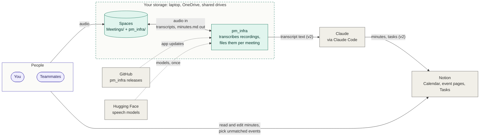
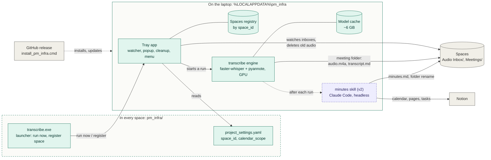
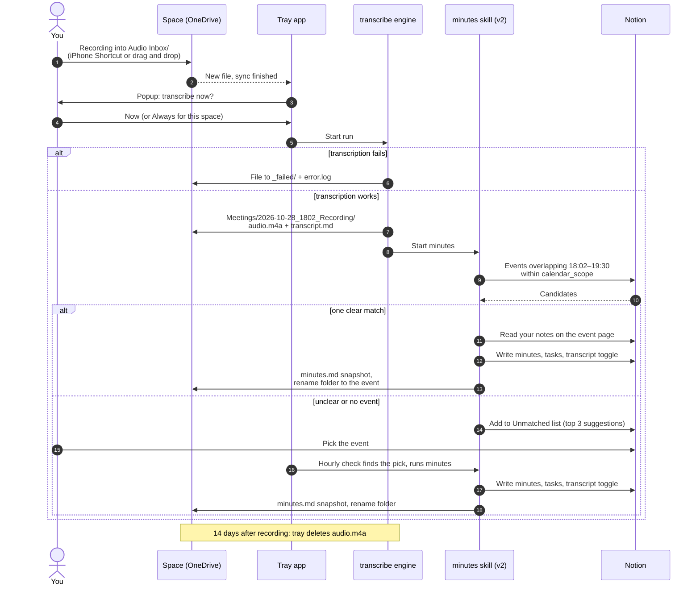

# pm_infra

Project-management infrastructure: local tools that turn meeting recordings into transcripts and minutes, filed under the right calendar event in Notion and in a folder on your drive.

> Status: v1 built (30 October 2026): installer, tray app, `transcribe`, spaces. The `minutes` step is v2 and not built; sections marked *(planned, v2)* describe it. Earlier design iterations are in `docs/design/`.

## What it does

1. You record a meeting on your iPhone or laptop.
2. The recording lands in the `Audio Inbox/` of a space.
3. `transcribe` creates a meeting folder and writes a transcript with timestamps and speaker labels, entirely on the laptop's GPU.
4. The `minutes` step finds the calendar event the recording belongs to, combines the transcript with the notes on that event's Notion page, and writes minutes and action items there. A snapshot of the minutes goes into the meeting folder.


## Context

What pm_infra is surrounded by, and what data crosses each line. Audio stays in your storage (laptop, OneDrive, shared drives); it never goes to Claude or Notion. Transcript and minutes text does, from v2 on.



## Containers

The parts pm_infra is made of and where each one runs. Dashed purple: arrives with v2.



## How a recording flows

The main scenario in time order, with what happens when transcription fails or no event matches. Same parts as the container diagram. Steps 8–18 arrive with v2.



## Concepts

### Space

A space is one folder with two parts: `Meetings/` for people and `pm_infra/` for the tool. Every space works the same way; two settings make it personal or team:

| | Personal space | Team space |
|---|---|---|
| Location, chosen at setup | `OneDrive/misc/Projects/` | a shared team drive |
| `calendar_scope` | `all`: every calendar you have | the team's calendar(s) only |
| Who drops files | you | anyone with folder access |

### Calendar scope

The `minutes` step looks for the event a recording belongs to, among the calendars in the space's `calendar_scope`. These are the calendars in the Notion Calendar of whoever runs the step: all your Notion databases plus connected iCloud and Google calendars. Calendars are stored by ID, so renaming one doesn't break anything.

## Modules

| Module | Does | Status |
|---|---|---|
| `transcribe` | audio → meeting folder with `transcript.md` | v1 |
| `minutes` | match event, write minutes to Notion + `minutes.md` snapshot | v2 |

Both share one install, one tray icon and one `project_settings.yaml` per space.

## Folder layout

```
OneDrive/misc/Projects/        personal space
├── Meetings/
│   ├── 2026-10-28_1800_Project kickoff/  matched: named after the event
│   │   ├── audio.m4a                         deleted after 14 days
│   │   ├── transcript.md
│   │   └── minutes.md                        snapshot of the Notion minutes
│   └── 2026-10-29_0910_Kickoff/              unmatched: original file name
└── pm_infra/
    ├── Audio Inbox/                          the phone always sends here
    ├── _failed/                              files that failed + error.log
    ├── _to_delete/                           original videos, 14 days
    ├── transcribe.exe                        double-click: process the inbox now
    ├── install_pm_infra.cmd                  installs the app on this laptop
    ├── project_settings.yaml
    ├── README.md
    └── .transcribing.lock                    hidden, managed by the app
```

A team space has the same two folders inside the team's shared drive, next to the team's own files.

## Meeting folders

- Created at transcription as `YYYY-MM-DD_HHMM_<original name>`. The date and time are the recording's, taken from the file name the Shortcut sets, else the media metadata, else the file date.
- Renamed to `YYYY-MM-DD_HHMM_<event title>` once matched, using the event's start date and time. A folder still carrying the original name is waiting for you to pick its event.
- Contents: `audio.m4a`, `transcript.md`, later `minutes.md`. A second recording of the same meeting becomes `transcript_2.md` with `audio_2.m4a`.
- Video input is converted to audio; the original video goes to `_to_delete/`. The same happens to audio that isn't already m4a (mp3, wav, ...): it is re-encoded to `audio.m4a` (AAC 96 kbit/s mono) and the original waits in `_to_delete/`.

## Settings

`pm_infra/project_settings.yaml`, optional (defaults apply when missing):

```yaml
space_id: 7f3c…                    # set at creation, never edit; identifies the space after a move
project: Team X
calendar_scope:                    # all | list of calendar IDs
  - <calendar ID>                  # Team X Meetings (Notion)
fallback_database: <Notion link>   # minutes for events without a Notion page
transcribe:
  default_language: auto           # auto | de | en | it
  on_new_files: ask                # ask | always
minutes:
  snapshot_to_folder: true         # write minutes.md
audio_retention_days: 14         # 0 keeps audio forever
```

The personal space uses `calendar_scope: all`. The app rewrites this file from a template when it changes a value (for example *Always for this space*), so the comments survive.

Nothing inside a space refers to absolute paths, so a space can be moved as a whole (see *Moving a space*).

## Transcript format

```markdown
---
source_file: 2026-10-28_1802_Recording.m4a
recorded_start: 2026-10-28T18:02:00+01:00
recorded_end: 2026-10-28T19:30:00+01:00
language: de
model: large-v3-turbo
speakers: 3
time_source: prefix
---

[00:00:04] SPEAKER_1: ...
```

Exact start and end times are what the `minutes` step matches on. `time_source` says where the start came from: `prefix` (file name), `metadata` (media creation time) or `file` (modified time, the least reliable: it's the upload time for files copied without the Shortcut). Without a Hugging Face token the lines carry no speaker label and the header says `speakers: none`. Lines of one speaker less than a second apart are merged.

## Setup

### Install

Run `install_pm_infra.cmd` (from any space, or from the `pm_infra` GitHub releases). It installs into `%LOCALAPPDATA%\pm_infra\`: a private copy of `uv`, Python 3.12, the environment (PyTorch with CUDA, about 3 GB), ffmpeg, the models (about 2 GB), and the launcher, compiled on the spot from `install/launcher/transcribe.cs` with the C# compiler that ships with Windows. It adds the tray app to start at login and an entry in Windows Settings → Apps (both under HKCU), and asks once for a Hugging Face token (for speaker labels; create a free account, accept the terms of `pyannote/speaker-diarization-3.1` and `pyannote/segmentation-3.0`, create a Read token). No admin rights. Needs an NVIDIA GPU; without one it still runs, slowly, on the CPU.

When run from a space's `pm_infra/` folder it registers that space. Otherwise, on a laptop with no spaces yet, it asks for the personal space folder (default: `OneDrive/misc/Projects/`) and creates the space there with `calendar_scope: all`. Running it again updates the app and keeps spaces, token and models.

From a checkout instead of a release: `install_pm_infra.cmd --from <folder>`. Flags passed through to `install/install.ps1`: `-PersonalSpace <folder>`, `-Token <hf_...>`, `-NoTray`, `-SkipModels`.

### New team space

Tray → **New space…**: pick the shared folder and a name. The installer starter, launcher and README are placed in its `pm_infra/` so teammates can install from there. The calendar picker for `calendar_scope` comes with v2; until then the space searches all calendars.

### iPhone Shortcut "Send to Transcribe"

1. Receive the recording (Voice Memos share sheet, or the end of "Record Audio").
2. Rename it to `<creation date yyyy-MM-dd_HHmm>_<memo title>`.
3. Save it to the personal space's `Audio Inbox/`. The inbox path is a single variable at the top of the Shortcut, so a moved space means one edit. If you're in team spaces, a menu offers them, personal first.
4. Notify "Sent".

## Daily use

| You want to… | Do this |
|---|---|
| Transcribe a laptop recording | Drop it in a space's `Audio Inbox/`, double-click `transcribe.exe` (or wait for the popup) |
| Send a Voice Memo | Share → Send to Transcribe |
| Handle new arrivals | Answer the popup: Transcribe now · Later · Always for this space. *Later* asks again in an hour or when another file arrives |
| Pick the event for an unmatched recording | Open the Unmatched list in Notion and choose the event (top three suggested) |

## Watcher and tray

- Polls every registered space's inbox every 5 seconds (polling, not file events: OneDrive placeholders make events unreliable). Idle cost is near 0% CPU, about 50 MB RAM.
- A file counts as arrived once its size has been stable for 10 seconds, nobody holds it open and OneDrive has downloaded it. If OneDrive left it online-only, the tray reads it once in the background so the download starts by itself.
- *Later* in the popup silences that space for an hour, or until another file arrives in its inbox.
- Asks before running: *"2 new recordings in Projects"* → Transcribe now · Later · Always for this space. On battery with *Run on battery* off, the first button becomes *Transcribe when plugged in*.
- A run is a separate console window (`python -m pm_infra run-now`), the same code path as `transcribe.exe`, so the tray survives any crash and the model memory is freed when the window closes. The window stays open on errors.
- Loads the models only for a run: speaker model first, freed, then Whisper (about 3 GB VRAM peak). Falls back to `medium` on GPU out-of-memory.
- Tray menu: New space… · Move space · Locate missing space (shown when a folder is missing) · Close space · Transcribe now · Run on battery (off by default) · Pause watcher · Open log folder · Uninstall… · Quit. Check for updates comes later.
- Deletes audio older than `audio_retention_days` once its transcript exists, and expired files in `_to_delete/`: at start and once a day.
- Logs: `%LOCALAPPDATA%\pm_infra\logs\pm_infra.log`.
- Hourly (v2): checks the Unmatched list in Notion and runs the `minutes` step for recordings you've picked an event for.

## Minutes step *(planned, v2)*

Runs after transcription as Claude Code in the background (`claude -p` with the `minutes` skill and the Notion connector). Needs the laptop on and Claude Code signed in; runs on your Claude plan.

1. **Find candidates:** events in `calendar_scope` that overlap the recording. All-day and "free" entries are ignored.
2. **Rank:** overlap ÷ combined span. Auto-pick only if the top score is ≥ 0.6 and leads the next by ≥ 0.2; these thresholds get tuned on real recordings.
3. **Clear match:** rename the meeting folder, write to the event's Notion page.
4. **Unclear or no event:** add to the Unmatched list in Notion with the top three suggestions. Once you pick, the tray's hourly check runs the step again for that recording.

The Notion page gets minutes on top (summary, decisions, action items), action items as entries in the Tasks database with owner and date, the transcript in a collapsed toggle, and the meeting folder's path relative to its space (`Projects / 2026-10-28_1800_…`), so it stays valid after a move. Never the audio. Events without a Notion page (iCloud, Google) get a new page in the space's `fallback_database`.

`minutes.md` in the meeting folder is a snapshot. Its first line says so and links the Notion page. Edit minutes in Notion.

## Defaults for edge cases

- Team meeting recorded to your personal inbox: minutes go to the team page; files stay in your space.
- Two recordings of one meeting: same folder, `transcript_2.md`, one set of minutes from both.
- Recurring events: each occurrence gets its own folder and page.
- Recording with no event: stays unmatched until you pick or create one.
- A failed run leaves nothing in `Meetings/`: the recording goes to `_failed/`, and a half-written folder or transcript is removed so a retry starts clean.
- A file that disappears from the inbox while a run waits for it (taken by another install, or removed by hand) is skipped at once, not waited for.
- Scope depends on who runs the step: a teammate running it needs the team calendar in their Notion Calendar.

## Moving a space

- **Tray → Move space**: pick the space, then its new parent folder. It pauses the watcher, moves the whole space folder (refused while a transcription is running), updates the list of spaces, resumes.
- **Moved in Explorer instead:** the tray notices the registered folder is missing and asks once whether to locate it (a Yes/No box, then a folder picker); it recognises the space by `space_id`. Decline, and *Locate missing space* stays in the tray menu. Double-clicking `transcribe.exe` in the new location also re-registers it.
- **Move space** refuses while a transcription is running; a lock older than six hours, or left by a process that no longer exists, is treated as a crash leftover and cleared.
- **Afterwards:** update the inbox path in the iPhone Shortcut (one variable). Teammates' installs re-register the same way.
- **Constraint:** the personal space must stay where the phone can upload to (inside OneDrive).

## Closing a space and uninstalling

- **Close space** (tray): unregisters the folder and deletes remaining audio after a confirmation. Transcripts, minutes and the folder stay.
- **Uninstall** (tray or Windows Settings → Apps): `install/uninstall.cmd` stops the tray, removes the start-at-login and Apps entries and `%LOCALAPPDATA%\pm_infra\` (app, environment, models, token). Spaces are never touched.

## Troubleshooting

| Symptom | Check |
|---|---|
| File stays in `Audio Inbox/` | Popup unanswered, watcher paused, on battery with "Run on battery" off, laptop asleep, or still syncing. Double-click `transcribe.exe`. |
| File in `_failed/` | Read `error.log`: unsupported format, corrupt file, GPU out of memory. |
| iPhone file never arrives | Open the OneDrive app on the iPhone to push the upload. |
| Folder keeps its original name | No clear event match; pick it in the Unmatched list. |
| Team meeting not matched | The team calendar isn't in the Notion Calendar of whoever ran the step. |
| Tray says a space is missing | It was moved or renamed; choose *Locate missing space* and point to its new folder. |
| No speaker labels, header says `speakers: none` | No Hugging Face token, or the model terms weren't accepted. Save the token to `%LOCALAPPDATA%\pm_infra\hf_token` and run `install-models` (or the installer) again. |
| `transcribe.exe` says pm_infra isn't installed | Run `install_pm_infra.cmd` next to it. |
| Phone recordings stop arriving after a move | Update the inbox path variable in the Shortcut. |
| `install-models` fails with `WinError 1314` (privilege not held) | Plain Windows accounts may not create symlinks. pm_infra decides that once per run and makes Hugging Face copy files instead, and retries interrupted downloads four times. Developer Mode is not needed; re-run `install-models`. |
| `error.log` shows a `TypeError` from PyAV / `av` while decoding | faster-whisper's own decoder broke with PyAV 19; pm_infra reads the 16 kHz wav itself and hands samples to Whisper. Update pm_infra (re-run the installer). |
| Tray crashes on start, log says a menu callback was rejected | pystray accepts callbacks with at most two parameters (icon, item). Fixed on 2 Nov 2026; update pm_infra. |
| `transcribe.exe` in a space is older than the installed app | Run `refresh-spaces` (the installer does it on every run) to update the launcher, starter and README in every registered space. |

## Roadmap

1. v1 (built): installer, tray app with watcher and popup, `transcribe`, personal space, New space (with `calendar_scope: all`), meeting folders, audio retention, `space_id` and Move space.
2. iPhone Shortcut (built by hand from this README).
3. Team spaces: calendar picker for `calendar_scope`, update checks.
4. v2: `minutes` skill, Notion writing, Unmatched list, `minutes.md` snapshot, folder rename.
5. Add-ons: Control Center button, refresh minutes from Notion, Teams instead of Notion.

## Repository

```
README.md                      this file: the spec
CLAUDE.md                      working rules for Claude Code
LICENSE                        MIT
pyproject.toml, uv.lock        package and pinned dependencies (Python 3.12, torch cu126)
install_pm_infra.cmd           installer starter; a copy sits in every space
install/install.ps1            the installer proper (Windows PowerShell 5.1 compatible)
install/uninstall.cmd          what Settings → Apps and the tray run
install/launcher/transcribe.cs the launcher, compiled at install time
install/space_README.md        README placed in each space's pm_infra/
src/pm_infra/                  the package: cli, tray, popup, inbox, engine, media, spaces, settings,
                               naming, lock, retention, windows_setup, paths, log
tests/                         pytest, no GPU needed
.github/workflows/release.yml  tag v* → pm_infra.zip on the GitHub release
docs/claude_code_prompt_v1.md  the v1 build brief
docs/plan_v1.md                the v1 build plan
docs/diagrams/                 diagram sources (.mmd) and renders (.png)
docs/design/                   design iterations (local only, not in git: contains personal calendar data)
```

Command line (`%LOCALAPPDATA%\pm_infra\env\Scripts\python.exe -m pm_infra ...`): `run-now --space <folder>`, `tray`, `new-space`, `register`, `list`, `refresh-spaces`, `cleanup`, `install-models`, `setup-windows [--remove]`, `version`.

Tests: `uv sync --frozen` then `uv run pytest` (the engine is covered by a real recording, not by tests).

## Decisions log

- Suite `pm_infra`; module `transcribe` first. Installer `install_pm_infra.cmd`. Public GitHub repo.
- Calendar-first design with spaces; personal and team spaces differ only in location and `calendar_scope`.
- Personal space: `OneDrive/misc/Projects/`, `calendar_scope: all`.
- One folder per meeting with audio, transcript and minutes; renamed after the matched event, using the event's start time.
- Notion is where minutes are edited; `minutes.md` is a snapshot.
- Audio and original videos deleted after 14 days, once transcribed.
- Watcher asks before running; battery runs toggled in the tray.
- Lock file `.transcribing.lock`, hidden.
- Spaces are movable: `space_id` in settings, no absolute paths inside a space, relative paths in Notion, Move space in the tray.
- Personal space is `OneDrive/misc/Projects/` itself, next to the existing project folders (30 Oct 2026).
- Engine: faster-whisper + pyannote called directly, not WhisperX; diarization first, then Whisper, models freed after each run. No token means no speaker labels, never a failed run.
- Launcher `transcribe.exe` is a 40-line C# program compiled on each laptop at install time with the compiler Windows ships: nothing downloaded as a binary, nothing bundled, so no antivirus or SmartScreen trouble.
- Installer: `install_pm_infra.cmd` starter + `install.ps1`; private `uv` and Python 3.12 under `%LOCALAPPDATA%\pm_infra`; registry entries only under HKCU.
- Non-m4a originals (mp3, wav, video) go to `_to_delete/` after transcoding, same 14 days.
- Transcript header gained `time_source`; *Later* in the popup snoozes a space for one hour; the tray has Quit, Transcribe now and Open log folder.
- Popup default stays *ask* (`on_new_files: ask`).
- Models: `huggingface_hub`'s symlink check is settled once before any download, so plain Windows accounts get copies instead of a `WinError 1314` crash; downloads retry up to four times (2 Nov 2026).
- Whisper receives samples read with `soundfile` from the 16 kHz wav, not a file path: faster-whisper's PyAV-based decoder broke with `av` 19 (2 Nov 2026).
- pystray menu callbacks take exactly `(icon, item)`; bound actions go through `TrayApp._bound` (2 Nov 2026).
- Review against the v1 brief (2 Nov 2026): a failed run leaves nothing in `Meetings/`; a vanished inbox file is skipped at once; the tray asks once to locate a missing space, downloads online-only inbox files in the background, and *Later* ends when another file arrives; *Move space* clears a stale lock and waits for the current poll pass; `register` and the new `refresh-spaces` command put the current `transcribe.exe`, starter and README into every space; the installer's default personal space is `%USERPROFILE%\OneDrive\misc\Projects` (the personal drive by folder name, since `%OneDrive%` may be the business drive).
