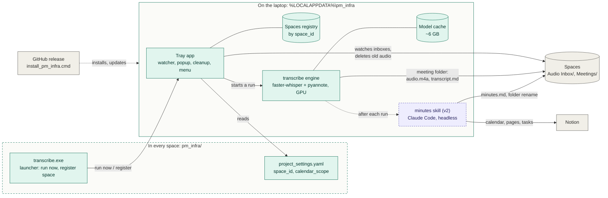
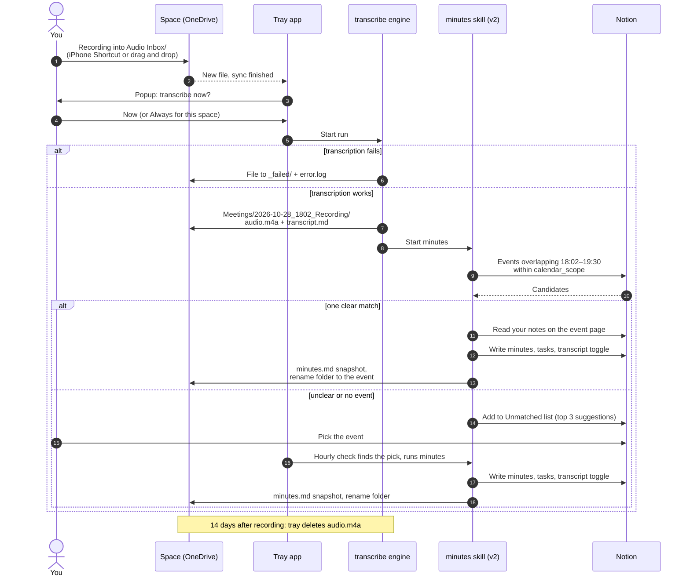

# pm_infra

Project-management infrastructure: local tools that turn meeting recordings into transcripts and minutes, filed under the right calendar event in Notion and in a folder on your drive.

> Status: design complete, v1 not built yet (29 October 2026). Sections marked *(planned)* describe intended behaviour. Earlier design iterations are in `docs/design/`.

## What it does

1. You record a meeting on your iPhone or laptop.
2. The recording lands in the `Audio Inbox/` of a space.
3. `transcribe` creates a meeting folder and writes a transcript with timestamps and speaker labels, entirely on the laptop's GPU.
4. The `minutes` step finds the calendar event the recording belongs to, combines the transcript with the notes on that event's Notion page, and writes minutes and action items there. A snapshot of the minutes goes into the meeting folder.


## Context

What pm_infra is surrounded by, and what data crosses each line. Audio stays in your storage (laptop, OneDrive, shared drives); it never goes to Claude or Notion. Transcript and minutes text does, from v2 on.


## Containers

The parts pm_infra is made of and where each one runs. Dashed purple: arrives with v2.



## How a recording flows

The main scenario in time order, with what happens when transcription fails or no event matches. Same parts as the container diagram. Steps 8–18 arrive with v2.



## Concepts

### Space

A space is one folder with two parts: `Meetings/` for people and `pm_infra/` for the tool. Every space works the same way; two settings make it personal or team:

| | Personal space | Team space |
|---|---|---|
| Location, chosen at setup | `OneDrive/misc/projects/misc_projects/` | a shared team drive |
| `calendar_scope` | `all`: every calendar you have | the team's calendar(s) only |
| Who drops files | you | anyone with folder access |

### Calendar scope

The `minutes` step looks for the event a recording belongs to, among the calendars in the space's `calendar_scope`. These are the calendars in the Notion Calendar of whoever runs the step: all your Notion databases plus connected iCloud and Google calendars. Calendars are stored by ID, so renaming one doesn't break anything.

## Modules

| Module | Does | Status |
|---|---|---|
| `transcribe` | audio → meeting folder with `transcript.md` | v1 |
| `minutes` | match event, write minutes to Notion + `minutes.md` snapshot | v2 |

Both share one install, one tray icon and one `project_settings.yaml` per space.

## Folder layout

```
OneDrive/misc/projects/misc_projects/        personal space
├── Meetings/
│   ├── 2026-10-28_1800_Project kickoff/  matched: named after the event
│   │   ├── audio.m4a                         deleted after 14 days
│   │   ├── transcript.md
│   │   └── minutes.md                        snapshot of the Notion minutes
│   └── 2026-10-29_0910_Kickoff/              unmatched: original file name
└── pm_infra/
    ├── Audio Inbox/                          the phone always sends here
    ├── _failed/                              files that failed + error.log
    ├── _to_delete/                           original videos, 14 days
    ├── transcribe.exe                        double-click: process the inbox now
    ├── install_pm_infra.cmd                  installs the app on this laptop
    ├── project_settings.yaml
    ├── README.md
    └── .transcribing.lock                    hidden, managed by the app
```

A team space has the same two folders inside the team's shared drive, next to the team's own files.

## Meeting folders

- Created at transcription as `YYYY-MM-DD_HHMM_<original name>`. The date and time are the recording's, taken from the file name the Shortcut sets, else the media metadata, else the file date.
- Renamed to `YYYY-MM-DD_HHMM_<event title>` once matched, using the event's start date and time. A folder still carrying the original name is waiting for you to pick its event.
- Contents: `audio.m4a`, `transcript.md`, later `minutes.md`. A second recording of the same meeting becomes `transcript_2.md`.
- Video input is converted to audio; the original video goes to `_to_delete/`.

## Settings

`pm_infra/project_settings.yaml`, optional (defaults apply when missing):

```yaml
space_id: 7f3c…                    # set at creation, never edit; identifies the space after a move
project: Team X
calendar_scope:                    # all | list of calendar IDs
  - <calendar ID>                  # Team X Meetings (Notion)
fallback_database: <Notion link>   # minutes for events without a Notion page
transcribe:
  default_language: auto           # auto | de | en | it
  on_new_files: ask                # ask | always
minutes:
  snapshot_to_folder: true         # write minutes.md
audio_retention_days: 14
```

The personal space uses `calendar_scope: all`.

Nothing inside a space refers to absolute paths, so a space can be moved as a whole (see *Moving a space*).

## Transcript format

```markdown
---
source_file: 2026-10-28_1802_Recording.m4a
recorded_start: 2026-10-28T18:02:00+01:00
recorded_end: 2026-10-28T19:30:00+01:00
language: de
model: large-v3-turbo
speakers: 3
---

[00:00:04] SPEAKER_1: ...
```

Exact start and end times are what the `minutes` step matches on.

## Setup *(planned)*

### Install

Run `install_pm_infra.cmd` (from any space, or from the `pm_infra` GitHub releases). It installs into `%LOCALAPPDATA%\pm_infra\`, downloads the models (about 6 GB), adds the tray app to start at login and asks once for a Hugging Face token (for speaker labels). No admin rights. Needs an NVIDIA GPU.

At the end it creates your personal space at `OneDrive/misc/projects/misc_projects/` with `calendar_scope: all`.

### New team space

Tray → **New space**: pick the shared folder, then tick the calendars this space searches. The installer starter, launcher and README are placed in its `pm_infra/` so teammates can install from there.

### iPhone Shortcut "Send to Transcribe"

1. Receive the recording (Voice Memos share sheet, or the end of "Record Audio").
2. Rename it to `<creation date yyyy-MM-dd_HHmm>_<memo title>`.
3. Save it to the personal space's `Audio Inbox/`. The inbox path is a single variable at the top of the Shortcut, so a moved space means one edit. If you're in team spaces, a menu offers them, personal first.
4. Notify "Sent".

## Daily use

| You want to… | Do this |
|---|---|
| Transcribe a laptop recording | Drop it in a space's `Audio Inbox/`, double-click `transcribe.exe` |
| Send a Voice Memo | Share → Send to Transcribe |
| Handle new arrivals | Answer the popup: Transcribe now · Later · Always for this space |
| Pick the event for an unmatched recording | Open the Unmatched list in Notion and choose the event (top three suggested) |

## Watcher and tray *(planned)*

- Watches every registered space's inbox. Idle cost is near 0% CPU, about 50 MB RAM.
- Asks before running: *"2 new recordings in misc_projects"* → Transcribe now · Later · Always for this space.
- Loads the model only for a run (about 2–3 GB VRAM).
- Tray menu: New space · Move space… · Close space · Run on battery (off by default) · Pause watcher · Uninstall · Check for updates (later).
- Deletes audio older than `audio_retention_days` once its transcript exists, and expired files in `_to_delete/`.
- Hourly (v2): checks the Unmatched list in Notion and runs the `minutes` step for recordings you've picked an event for.

## Minutes step *(planned, v2)*

Runs after transcription as Claude Code in the background (`claude -p` with the `minutes` skill and the Notion connector). Needs the laptop on and Claude Code signed in; runs on your Claude plan.

1. **Find candidates:** events in `calendar_scope` that overlap the recording. All-day and "free" entries are ignored.
2. **Rank:** overlap ÷ combined span. Auto-pick only if the top score is ≥ 0.6 and leads the next by ≥ 0.2; these thresholds get tuned on real recordings.
3. **Clear match:** rename the meeting folder, write to the event's Notion page.
4. **Unclear or no event:** add to the Unmatched list in Notion with the top three suggestions. Once you pick, the tray's hourly check runs the step again for that recording.

The Notion page gets minutes on top (summary, decisions, action items), action items as entries in the Tasks database with owner and date, the transcript in a collapsed toggle, and the meeting folder's path relative to its space (`misc_projects / 2026-10-28_1800_…`), so it stays valid after a move. Never the audio. Events without a Notion page (iCloud, Google) get a new page in the space's `fallback_database`.

`minutes.md` in the meeting folder is a snapshot. Its first line says so and links the Notion page. Edit minutes in Notion.

## Defaults for edge cases

- Team meeting recorded to your personal inbox: minutes go to the team page; files stay in your space.
- Two recordings of one meeting: same folder, `transcript_2.md`, one set of minutes from both.
- Recurring events: each occurrence gets its own folder and page.
- Recording with no event: stays unmatched until you pick or create one.
- Scope depends on who runs the step: a teammate running it needs the team calendar in their Notion Calendar.

## Moving a space *(planned)*

- **Tray → Move space…**: pauses the watcher, moves the whole space folder, updates the list of spaces, resumes.
- **Moved in Explorer instead:** the app finds the registered folder missing and asks you to locate it; it recognises the space by `space_id`. Double-clicking `transcribe.exe` in the new location also re-registers it.
- **Afterwards:** update the inbox path in the iPhone Shortcut (one variable). Teammates' installs re-register the same way.
- **Constraint:** the personal space must stay where the phone can upload to (inside OneDrive).

## Closing a space and uninstalling *(planned)*

- **Close space** (tray): unregisters the folder and deletes remaining audio after a confirmation. Transcripts, minutes and the folder stay.
- **Uninstall** (tray or Windows Settings → Apps): removes the start-at-login entry, `%LOCALAPPDATA%\pm_infra\` and the model cache. Spaces are never touched.

## Troubleshooting

| Symptom | Check |
|---|---|
| File stays in `Audio Inbox/` | Popup unanswered, watcher paused, on battery with "Run on battery" off, laptop asleep, or still syncing. Double-click `transcribe.exe`. |
| File in `_failed/` | Read `error.log`: unsupported format, corrupt file, GPU out of memory. |
| iPhone file never arrives | Open the OneDrive app on the iPhone to push the upload. |
| Folder keeps its original name | No clear event match; pick it in the Unmatched list. |
| Team meeting not matched | The team calendar isn't in the Notion Calendar of whoever ran the step. |
| Tray says a space is missing | It was moved or renamed; choose *Locate…* and point to its new folder. |
| Phone recordings stop arriving after a move | Update the inbox path variable in the Shortcut. |

## Roadmap

1. v1: installer, tray app with watcher and popup, `transcribe`, personal space, New space (with `calendar_scope: all`), meeting folders, audio retention, `space_id` and Move space.
2. iPhone Shortcut (built by hand from this README).
3. Team spaces: calendar picker for `calendar_scope`, update checks.
4. v2: `minutes` skill, Notion writing, Unmatched list, `minutes.md` snapshot, folder rename.
5. Add-ons: Control Center button, refresh minutes from Notion, Teams instead of Notion.

## Repository

```
README.md                      this file: the spec
CLAUDE.md                      working rules for Claude Code
docs/claude_code_prompt_v1.md  the v1 build brief
docs/diagrams/                 diagram sources (.mmd) and renders (.png)
docs/design/                   design iterations (local only, not in git: contains personal calendar data)
```

## Decisions log

- Suite `pm_infra`; module `transcribe` first. Installer `install_pm_infra.cmd`. Public GitHub repo.
- Calendar-first design with spaces; personal and team spaces differ only in location and `calendar_scope`.
- Personal space: `OneDrive/misc/projects/misc_projects/`, `calendar_scope: all`.
- One folder per meeting with audio, transcript and minutes; renamed after the matched event, using the event's start time.
- Notion is where minutes are edited; `minutes.md` is a snapshot.
- Audio and original videos deleted after 14 days, once transcribed.
- Watcher asks before running; battery runs toggled in the tray.
- Lock file `.transcribing.lock`, hidden.
- Spaces are movable: `space_id` in settings, no absolute paths inside a space, relative paths in Notion, Move space in the tray.
